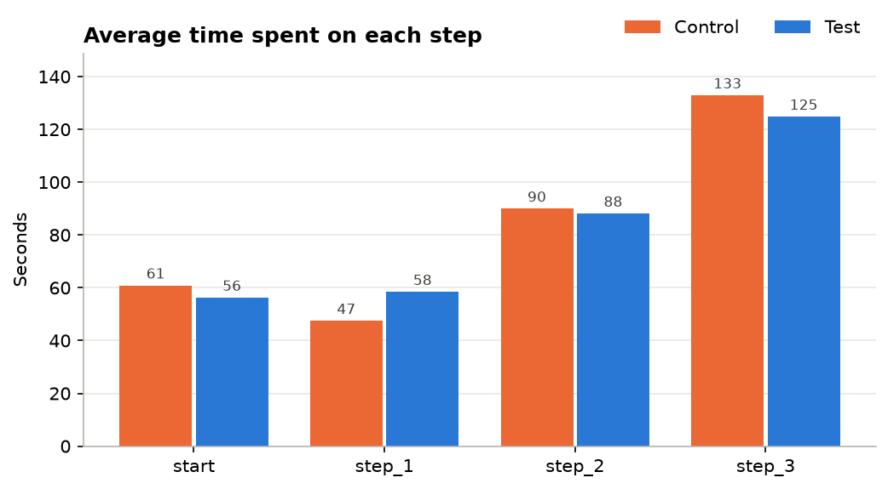
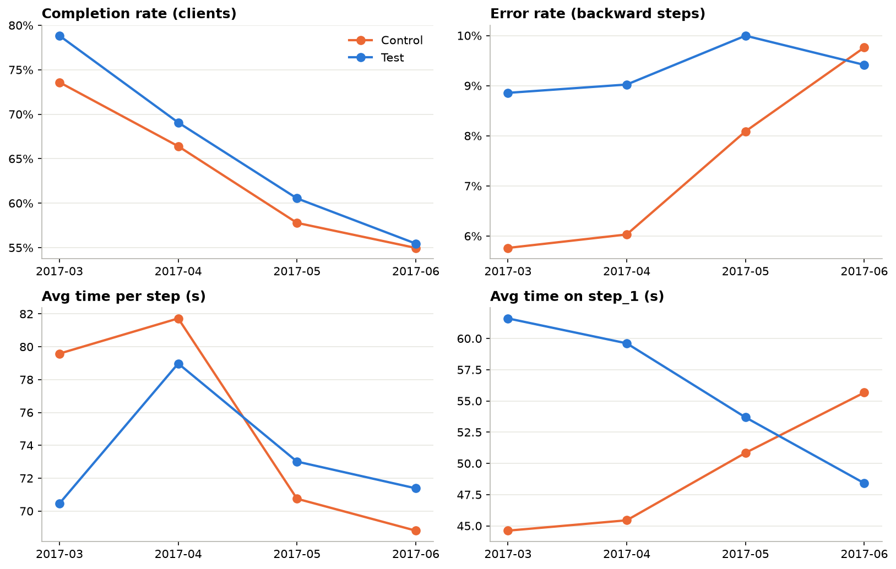

# Vanguard A/B Test – Digital Process Redesign

> Ironhack Data Analytics Bootcamp – Project 2 (Weeks 5–6)
> **Team Ravenclaw:** Juliana Therezo · Raquel Marques · Lervin

## 📌 Project overview

From **15 Mar 2017 to 20 Jun 2017**, Vanguard's Customer Experience (CX) team ran an A/B test. The goal was to find out whether a more modern UI with in-context prompts helps more clients complete an online process
(`start → step_1 → step_2 → step_3 → confirm`).

- **Control group (Old Website):** the traditional online process
- **Test group (New Website):** the new, redesigned digital interface

**Main question:** did the new design raise the completion rate, and by enough (≥ 5 %) to justify its cost?

## 🔗 Links

| What | Link |
|---|---|
| 📊 Tableau Public dashboard | [Vanguard AB Test – Dashboard](https://public.tableau.com/app/profile/juliana.therezo/viz/VanguardABTest_Dashboard/Overview) |
| 🖥️ Presentation slides | _To be uploaded_ |
| 📋 Kanban board (Trello) | https://trello.com/b/jXS0m9Dt/vanguard-a-b-test-project-2-juliana-raquel-lervin |
| 📂 Data sources (folder) | https://github.com/data-bootcamp-v4/lessons/tree/main/5_6_eda_inf_stats_tableau/project/files_for_project |

## 🏁 Key results at a glance

| KPI | Old Website (Control) | New Website (Test) | Test result | New design |
|---|---|---|---|---|
| **Completion rate** (clients who reached `confirm`) | 65.6 % | 69.3 % | +3.7 pp, p < 0.001 | ✅ Better |
| **5 % cost-effectiveness threshold** | – | – | +3.7 pp (+5.7 % relative), not significant above 5 % | ⚠️ Not proven |
| **Error rate** (backward steps ÷ all steps) | 6.7 % | 9.2 % | +2.4 pp, p < 0.001 | ❌ Worse |
| **Time on `start`** | 60.9 s | 56.3 s | −4.6 s, p < 0.001 | ✅ Faster |
| **Time on `step_1`** | 47.5 s | 58.4 s | +11.0 s, p ≈ 1.0 | ❌ Slower |
| **Time on `step_2`** | 90.0 s | 88.1 s | −1.9 s, p = 0.025 | ✅ Faster |
| **Time on `step_3`** | 132.9 s | 124.8 s | −8.1 s, p < 0.001 | ✅ Faster |

**In one sentence:** with the new design, more clients finish and most steps are faster, but the gain isn't proven to be cost-effective yet, and all three KPIs point to one weak spot: **`step_1`**.

## 📂 Data sources

| # | Dataset | File | Description | Cleaning owner |
|---|---|---|---|---|
| 1 | Client Profiles | [df_final_demo.txt](https://github.com/data-bootcamp-v4/lessons/blob/main/5_6_eda_inf_stats_tableau/project/files_for_project/df_final_demo.txt) | Demographics: age, gender, tenure, accounts, balance, calls, logons | Lervin |
| 2 | Digital Footprints | [df_final_web_data_pt_1.txt](https://github.com/data-bootcamp-v4/lessons/blob/main/5_6_eda_inf_stats_tableau/project/files_for_project/df_final_web_data_pt_1.txt) + [df_final_web_data_pt_2.txt](https://github.com/data-bootcamp-v4/lessons/blob/main/5_6_eda_inf_stats_tableau/project/files_for_project/df_final_web_data_pt_2.txt) | Every web interaction (visitor, visit, step, timestamp) | Raquel |
| 3 | Experiment Roster | [df_final_experiment_clients.txt](https://github.com/data-bootcamp-v4/lessons/blob/main/5_6_eda_inf_stats_tableau/project/files_for_project/df_final_experiment_clients.txt) | Which clients were in the Test or Control group | Juliana |

## 🗂️ Repository structure

```
vanguard-ab-test/
├── data/
│   ├── raw/                     # original source files
│   ├── clean/                   # cleaned outputs (the large merged CSV stays local, see below)
│   └── tableau/                 # tidy tables that feed the Tableau dashboard
│       ├── tableau_clients.csv        # one row per client (profile, group, completion)
│       ├── tableau_steps.csv          # one row per web action (step, time on step, backward flag)
│       └── tableau_test_results.csv   # all hypothesis-test results in one table
├── notebooks/
│   ├── Customer_Profiles_Overview_Lervin(df_final_demo.txt).ipynb   # 1. Client Profiles cleaning + EDA – Lervin
│   ├── df_final_web_data.ipynb                                      # 2. Digital Footprints cleaning – Raquel
│   ├── Data cleaning_df_final_experiment_clients.ipynb              # 3. Experiment Roster cleaning – Juliana
│   ├── Vanguard_Merge_Files.ipynb                                   # merge of the 3 datasets
│   ├── KPI - Completion Rate.ipynb                                  # KPI 1 – Lervin
│   ├── KPI - Time spent on each step.ipynb                          # KPI 2 – Juliana
│   ├── KPI - error_rate_analysis_final.ipynb                        # KPI 3 – Raquel
│   └── Experiment evaluation.ipynb                                  # design, duration, final verdict
├── src/
│   └── cleaning.py              # reusable cleaning functions
├── figures/                     # charts exported from the notebooks
├── tableau/
│   └── Vanguard AB Test_Dashboard.twbx   # final Tableau workbook
├── slides/
│   └── icons/                   # icons used in the presentation (deck to be uploaded)
├── requirements.txt
└── README.md
```

## ⚙️ How to run

```bash
pip install -r requirements.txt
```

1. Run the three cleaning notebooks. They create the files in `data/clean/`.
2. Run `Vanguard_Merge_Files.ipynb` to build `vanguard_master_merged.csv`. It's **~86 MB**, too large for GitHub, so it isn't committed. The zipped version `data/clean/vanguard_master_merged.zip` is in the repo instead.
3. Run the KPI notebooks, then `Experiment evaluation.ipynb`.
4. Open `tableau/Vanguard AB Test_Dashboard.twbx` in Tableau Public, or use the online link above.

## 🧹 Data cleaning

- **Client Profiles (Lervin):** 70,609 clients audited. Median age **47**, median tenure **11 years**, median balance **$63,333**. The mean is $147,445 because of a few very large accounts. On average, **5.6 logons** and **3.4 calls** in 6 months.
- **Digital Footprints (Raquel):** both parts merged (755,405 rows). **10,764 exact duplicates (1.4 %)** were removed, leaving **744,641 actions**, and `date_time` was converted to datetime.
- **Experiment Roster (Juliana):** 70,609 clients, with no duplicates or invalid IDs. 20,109 clients (28.5 %) have no group and were left out of the test. That leaves **50,500 clients: 26,968 Test (53.4 %) and 23,532 Control (46.6 %)**.

**Shared rules for the KPIs:**
- Keep only Test and Control clients.
- A visit is `client_id` + `visit_id`, because the same `visit_id` is reused by different clients.
- Actions are sorted in time order. When two actions share the same second, the earlier step goes first.
- Gaps over 30 minutes are excluded from time on step.

## 🔍 EDA – Who are the clients?

- Mostly **long-standing, financially established, middle-aged clients**. The largest segment is **45–59 years** (~31 %).
- Gender is split evenly between female, male and unknown (about one third each).
- Age, tenure, balance, number of accounts and gender mix are **practically the same in Test and Control**. So differences in the KPIs come from the design, not the clients.

## 📊 KPIs & 🧪 hypothesis tests

### 1. Completion rate – Lervin
Two-proportion z-test / chi-square, H₁: Test > Control. **69.3 % vs 65.6 %**, p < 0.001 → the new design completes **significantly more** clients.

**5 % threshold:** the increase is **+3.7 pp**, with a 95 % CI of 2.9 – 4.5 pp, so it is clearly **below 5 percentage points**. As a relative increase it's **+5.7 %**, but that isn't significantly above 5 %. Either way, the threshold is **not proven**.

### 2. Time spent on each step – Juliana
One-sided two-sample t-test per step, H₁: Test is faster. The new design is **faster on `start`, `step_2` and `step_3`**, but **~11 s slower on `step_1`** (+23 %).
Month by month, the extra time on `step_1` shrinks from **+17 s in March to −7 s in June**, which looks like a **learning effect**.



### 3. Error rate (backward steps) – Raquel
Two-proportion z-test. **9.2 % vs 6.8 %** (+2.4 pp, p < 0.001). The result holds at visit level (26.8 % vs 20.0 % of visits with an error) and at client level (33.4 % vs 25.8 %).
The biggest difference is **`step_1 → start`**: Test clients go back about **twice as often** as Control. In the new design, visits with an error complete far less often (42 % vs 65 %).

## 🧭 Experiment evaluation

| Check | Result | OK? |
|---|---|---|
| Each client saw only one design | 0 clients in both groups | ✅ |
| Both designs ran at the same time | 15 Mar – 20 Jun 2017 | ✅ |
| 50/50 split | 53.4 % Test / 46.6 % Control (chi-square p < 0.001) | ⚠️ |
| Similar clients | Profiles differ by ≤ 1–2 % | ✅ |
| Duration | Enough clients, but ~80 % entered in March–April (tax season) and the KPIs were still moving in June | ⚠️ |



**Possible biases:**
- Novelty and learning effects.
- The unequal split.
- Repeated visits by the same client.
- No device or browser data.
- Only clients who started the process are included.

**Additional data that would help:**
- Device and browser.
- In-page events (clicks, form errors, help clicks).
- Exit reasons.
- Page load time.
- Satisfaction (CSAT/NPS) and calls after the visit.
- Value of a completed process, to measure the 5 % threshold in money.

## ✅ Conclusions & recommendations

The new design **works better overall**: more clients complete and most steps are faster. But the gain is **not yet proven to be cost-effective**, and there's one clear weak point: **`step_1`**. That's where clients spend extra time and go back to the start twice as often.

1. **Don't roll out the new design as it is yet.**
2. **Fix `step_1` first.** It's the main source of errors and extra time.
3. **Run a longer follow-up test** outside the tax season to measure the long-term effect.
4. **Collect the missing data** (device, in-page events, exit reasons, value per completion).
5. **Agree on the definition of the 5 % threshold** (percentage points or relative) with the business.

## 👥 Team & project management

| Member | Main responsibilities |
|---|---|
| Juliana Therezo | Experiment roster cleaning · KPI time on each step · experiment evaluation · Tableau dashboard |
| Raquel Marques | Digital footprints cleaning · KPI error rate |
| Lervin | Client profiles cleaning & EDA · data merge · KPI completion rate |

Tasks are split and tracked on our [Trello board](https://trello.com/b/jXS0m9Dt/vanguard-a-b-test-project-2-juliana-raquel-lervin).
